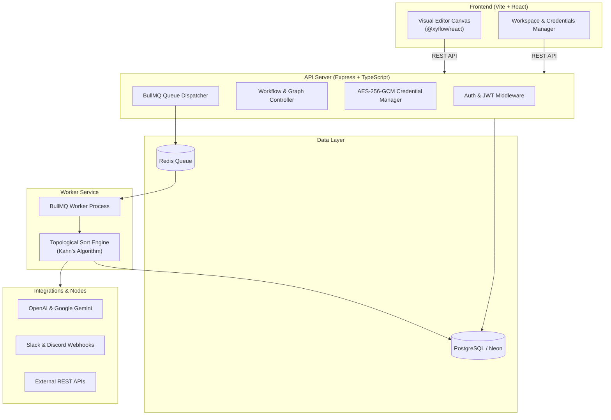

# ⚡ Workflow Automation Platform (n8n Clone)

> An open-source, developer-friendly visual workflow automation platform inspired by **n8n**. Build, automate, and orchestrate complex business logic, AI models, APIs, databases, webhooks, and team alerts — visually or with code.

---

## ✨ Features

- 🎨 **Visual Drag-and-Drop Canvas**: Built with `@xyflow/react` (React Flow) for smooth zooming, panning, node configuration, and connection routing.
- 🔀 **Handle-Aware Branching**: Real conditional evaluation with dual-handled IF nodes (`true` and `false` output routing) and branch skipping.
- 🤖 **Built-in AI Nodes**: Call **OpenAI** (or compatible like Groq, Ollama, OpenRouter) and **Google Gemini** with custom prompts and variable templating.
- 🗄️ **Database Nodes**: Run custom PostgreSQL queries directly against your database (Neon / local Postgres).
- 💬 **Team Notifications**: Integrated Slack and Discord webhook alert dispatchers.
- ⚡ **Asynchronous Execution Queue**: BullMQ + Redis background worker architecture capable of high-throughput execution off the request thread.
- 🔒 **Encrypted Credentials Vault**: API keys, database credentials, and secret tokens are encrypted at rest with **AES-256-GCM** and never exposed to the client.
- ⏰ **Triggers & Webhooks**: Public incoming webhook ingestion and automated Cron-based repeatable scheduling.
- 🧪 **Interactive Testing**: Test individual nodes or entire workflows synchronously and inspect duration and outputs directly inside the canvas.

---

## ⚡ 1-Minute Quickstart

Choose your preferred way to run: **Docker** (recommended for zero setup) or **Local Node.js**.

### Option A: With Docker (Zero Configuration)

If you have Docker Desktop installed, start the entire stack in one command:

```bash
# 1. Clone the repository
git clone https://github.com/your-username/n8n-clone.git
cd n8n-clone

# 2. Start PostgreSQL, Redis, Backend, Worker, and Frontend
docker compose up -d
```

Open your browser at **[http://localhost:5173](http://localhost:5173)**!

---

### Option B: Local Node.js (with Neon or Local Postgres)

```bash
# 1. Clone the repository
git clone https://github.com/your-username/n8n-clone.git
cd n8n-clone

# 2. Install all dependencies (root, backend, frontend)
npm run install:all

# 3. Run the automated 1-click setup
# (Generates .env files, encryption keys, syncs database, and seeds demo data)
npm run setup

# 4. Start all services together (API Server, Queue Worker, and Vite UI)
npm run dev
```

Open your browser at **[http://localhost:5173](http://localhost:5173)**!

---

## 🔑 Default Demo Account

When you start the application for the first time, a demo account and a **pre-built showcase workflow** are seeded automatically:

| Field | Value |
| :--- | :--- |
| **Email** | `demo@example.com` |
| **Password** | `password123` |
| **Workspace** | `Demo Workspace` |
| **Showcase Workflow** | *Showcase: Data Transform & Branching* |

---

## 🏗️ Architecture



---

## 🧩 Node Library

The platform includes 11 production-ready node types:

| Category | Node Name | Description | Key Config |
| :--- | :--- | :--- | :--- |
| **Triggers** | `trigger.manual` | Starts execution on demand via "Test" or "Run" | None |
| **Triggers** | `trigger.webhook` | Public webhook URL that triggers workflow on POST | Unguessable token URL |
| **Triggers** | `trigger.schedule` | Cron schedule trigger using Redis schedulers | Cron expression (e.g. `*/5 * * * *`) |
| **Actions** | `http.request` | Calls external REST APIs (`GET`, `POST`, `PUT`, `DELETE`) | URL, Method, Body, Credential |
| **AI** | `ai.prompt` | Generates text using OpenAI or Gemini models | Model, Prompt, System Prompt |
| **Database** | `db.postgres` | Executes raw SQL against PostgreSQL / Neon | Query (`SELECT`, `INSERT`, etc.) |
| **Communication**| `communication.webhook` | Sends alerts to Slack or Discord webhooks | Platform, Webhook URL, Message |
| **Logic** | `logic.if` | Routes execution to `true` or `false` branch handle | JS Condition (e.g. `input.score > 80`) |
| **Logic** | `logic.wait` | Pauses execution for a specified duration | Seconds (1–60s) |
| **Data** | `data.setVariable` | Sets shared workflow context variables | Key, Value |
| **Data** | `data.code` | Custom JavaScript code transformation | JS snippet with `return` statement |

### Dynamic Expressions & Templating
All action, AI, HTTP, and notification nodes support template strings:
- Access upstream input: `{{ input.property }}`
- Access workflow variables: `{{ variables.myKey }}`
- Example: `Hello {{ input.user.name }}! Your score is {{ input.score }}.`

---

## 🔒 Security & Credentials Vault

- **Zero Plaintext Secrets**: All API tokens and credentials saved in workspace settings are encrypted with `aes-256-gcm` using a 32-byte secret key before reaching the database.
- **In-Memory Injection**: At execution time, credentials are decrypted in-memory only for the running node and injected as runtime headers (e.g. `Authorization: Bearer <token>`).
- **Unguessable Webhook Tokens**: Webhooks use 128-bit cryptographically random tokens and run outside JWT boundaries for public endpoint consumption.

---

## 📁 Repository Structure

```
├── backend/
│   ├── prisma/                # Schema files & database seed script
│   ├── src/
│   │   ├── controllers/       # REST API endpoints (Workflows, Executions, Credentials)
│   │   ├── engine/            # Kahn's topological sort execution engine & branching
│   │   │   └── executors/     # Individual node execution handlers
│   │   ├── queue/             # BullMQ Redis queue connection & definition
│   │   ├── routes/            # Express route declarations
│   │   ├── utils/             # Expression interpolation & helpers
│   │   ├── index.ts           # Express server entry point
│   │   └── worker.ts          # BullMQ queue worker process
│   └── Dockerfile             # Backend container image
├── frontend/
│   ├── src/
│   │   ├── components/        # Canvas, NodePalette, NodeConfigPanel, TestResults
│   │   ├── nodes/             # Visual node definitions & styles
│   │   ├── pages/             # Dashboard, Workspace, Canvas Editor, Executions
│   │   └── store/             # Zustand auth store
│   ├── nginx.conf             # Production Nginx reverse proxy
│   └── Dockerfile             # Frontend container image
├── scripts/
│   ├── setup.mjs              # 1-click automated project setup script
│   └── dev.mjs                # Multi-service parallel development runner
├── docker-compose.yml         # Full-stack Docker orchestration
└── README.md
```

---

## 📜 Available NPM Scripts

From the repository root:

- `npm run setup` — One-click initialization: generates `.env` files, runs migrations, and seeds the database.
- `npm run dev` — Starts the backend API, queue worker, and frontend dev server simultaneously.
- `npm run install:all` — Installs npm packages across root, backend, and frontend.
- `npm run build` — Compiles TypeScript backend and builds Vite production frontend bundle.
- `npm run db:studio` — Launches Prisma Studio for visual database inspection.

---

## 📄 License

MIT License. Free to use, modify, and distribute for personal and commercial projects.
