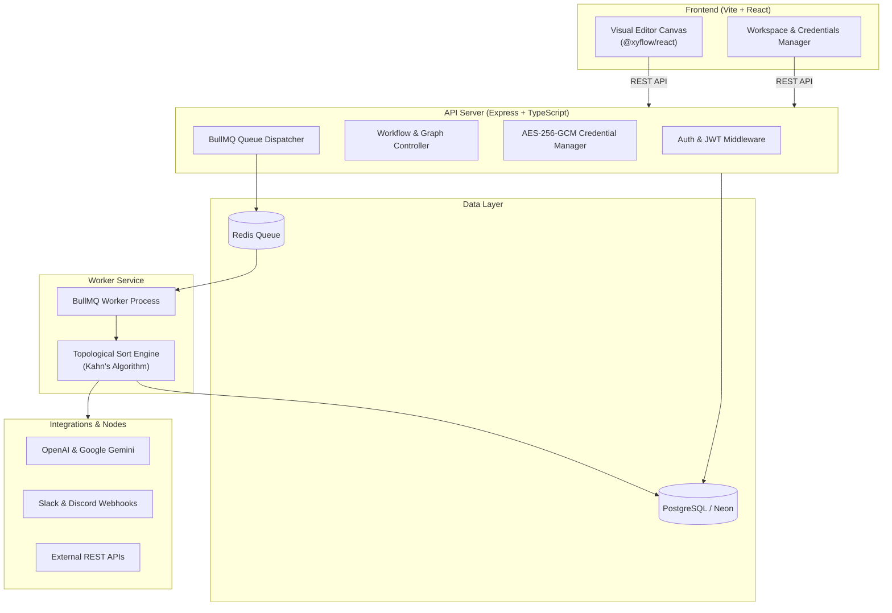

# ⚡ Knotrun — Industrial In-Memory DAG Workflow Engine & Studio

> A sub-millisecond in-memory DAG execution engine operating at 81,000+ ops/sec with Kahn's topological sorting $O(V+E)$, sandboxed Node.js V8 `vm` execution contexts, BullMQ distributed queues with Redis TLS, and zero-trust pre-flight SSRF network firewalling.

---

## 🌐 Live Deployments

- **3D Interactive Architecture Runway**: [https://knotrun-landing.onrender.com](https://knotrun-landing.onrender.com)
- **Knotrun Studio App (1-Click Guest & Recruiter Demo)**: [https://knotrun-studio.onrender.com/dashboard](https://knotrun-studio.onrender.com/dashboard)

---

## ✨ Architectural Highlights

- ⚡ **Pure In-Memory DAG Resolution**: Workflow dependencies are resolved in-memory using Kahn's topological algorithm in $O(V+E)$ time, completely decoupled from database roundtrips for bounded microsecond execution.
- 🛡️ **V8 Sandboxed Code Execution**: Custom JavaScript nodes run in isolated Node.js `vm` contexts with script compilation caching, memory caps, and execution timeouts.
- 🔒 **Zero-Trust Pre-Flight SSRF Firewall**: Every outgoing HTTP and Webhook request validates DNS resolutions and IP ranges against AWS metadata (`169.254.169.254`), loopbacks, and private RFC-1918 subnets.
- 🎨 **Visual Drag-and-Drop Canvas**: Built with `@xyflow/react` (React Flow) for zooming, panning, node configuration, and handle-aware connection routing.
- 🔀 **Handle-Aware Branching**: Dual-handled IF evaluation (`true` / `false` output routing) with automated branch skipping.
- 🤖 **Built-in AI & Database Nodes**: Gemini & OpenAI model calls, PostgreSQL custom queries (Neon DB), Slack/Discord webhook alerts, and Cron scheduling.
- ⚡ **Distributed Queue Buffer**: Upstash Redis TLS + BullMQ background queue worker architecture for high-concurrency burst absorption.
- 🔐 **Encrypted Credentials Vault**: API keys and database credentials encrypted at rest with **AES-256-GCM**.

---

## ⚡ 1-Minute Quickstart

Choose your preferred way to run: **Local Node.js** or **Docker**.

### Option A: Local Node.js (Recommended)

```bash
# 1. Clone the repository
git clone https://github.com/jatin50/Knotrun_workflow.git
cd Knotrun_workflow

# 2. Install dependencies across root, backend, and frontend
npm run install:all

# 3. Run the automated 1-click setup
# (Generates .env files, encryption keys, syncs database, and seeds demo data)
npm run setup

# 4. Start all services together (API Server, Queue Worker, and Vite UI)
npm run dev
```

Open your browser at **[http://localhost:5173](http://localhost:5173)**!

---

### Option B: With Docker (Zero Configuration)

```bash
# 1. Clone the repository
git clone https://github.com/jatin50/Knotrun_workflow.git
cd Knotrun_workflow

# 2. Start PostgreSQL, Redis, Backend, Worker, and Frontend
docker compose up -d
```

Open your browser at **[http://localhost:5173](http://localhost:5173)**!

---

## 🔑 Recruiter & Demo Access

The platform supports **instant 1-click Guest Mode** with zero authentication barrier. For full account testing, demo credentials are pre-seeded:

| Field | Value |
| :--- | :--- |
| **Email** | `recruiter@knotrun.io` / `demo@example.com` |
| **Password** | `password123` |
| **Workspace** | `Enterprise In-Memory Workspace` |
| **Showcase Workflow** | *Production DAG: AI Categorization & Webhook Relay* |

---

## 🏗️ Architecture



---

## 🧩 Node Library

The platform includes 11 production-ready node types:

| Category | Node Name | Description | Key Config |
| :--- | :--- | :--- | :--- |
| **Triggers** | `trigger.manual` | Starts execution on demand via "Test" or "Run" | None |
| **Triggers** | `trigger.webhook` | Public webhook URL that triggers workflow on POST | Unguessable token URL |
| **Triggers** | `trigger.schedule` | Cron schedule trigger using Redis schedulers | Cron expression (e.g. `*/5 * * * *`) |
| **Actions** | `http.request` | Calls external REST APIs (`GET`, `POST`, `PUT`, `DELETE`) | URL, Method, Body, Credential |
| **AI** | `ai.prompt` | Generates text using OpenAI or Gemini models | Model, Prompt, System Prompt |
| **Database** | `db.postgres` | Executes raw SQL against PostgreSQL / Neon | Query (`SELECT`, `INSERT`, etc.) |
| **Communication**| `communication.webhook` | Sends alerts to Slack or Discord webhooks | Platform, Webhook URL, Message |
| **Logic** | `logic.if` | Routes execution to `true` or `false` branch handle | JS Condition (e.g. `input.score > 80`) |
| **Logic** | `logic.wait` | Pauses execution for a specified duration | Seconds (1–60s) |
| **Data** | `data.setVariable` | Sets shared workflow context variables | Key, Value |
| **Data** | `data.code` | Custom JavaScript code transformation | JS snippet with `return` statement |

### Dynamic Expressions & Templating
All action, AI, HTTP, and notification nodes support template strings:
- Access upstream input: `{{ input.property }}`
- Access workflow variables: `{{ variables.myKey }}`
- Example: `Hello {{ input.user.name }}! Your score is {{ input.score }}.`

---

## 🔒 Security & Credentials Vault

- **Zero Plaintext Secrets**: All API tokens and credentials saved in workspace settings are encrypted with `aes-256-gcm` using a 32-byte secret key before reaching the database.
- **In-Memory Injection**: At execution time, credentials are decrypted in-memory only for the running node and injected as runtime headers (e.g. `Authorization: Bearer <token>`).
- **Unguessable Webhook Tokens**: Webhooks use 128-bit cryptographically random tokens and run outside JWT boundaries for public endpoint consumption.

---

## 📁 Repository Structure

```
├── backend/
│   ├── prisma/                # Schema files & database seed script
│   ├── src/
│   │   ├── controllers/       # REST API endpoints (Workflows, Executions, Credentials)
│   │   ├── engine/            # Kahn's topological sort execution engine & branching
│   │   │   └── executors/     # Individual node execution handlers
│   │   ├── queue/             # BullMQ Redis queue connection & definition
│   │   ├── routes/            # Express route declarations
│   │   ├── utils/             # Expression interpolation & helpers
│   │   ├── index.ts           # Express server entry point
│   │   └── worker.ts          # BullMQ queue worker process
│   └── Dockerfile             # Backend container image
├── frontend/
│   ├── src/
│   │   ├── components/        # Canvas, NodePalette, NodeConfigPanel, TestResults
│   │   ├── nodes/             # Visual node definitions & styles
│   │   ├── pages/             # Dashboard, Workspace, Canvas Editor, Executions
│   │   └── store/             # Zustand auth store
│   ├── nginx.conf             # Production Nginx reverse proxy
│   └── Dockerfile             # Frontend container image
├── scripts/
│   ├── setup.mjs              # 1-click automated project setup script
│   └── dev.mjs                # Multi-service parallel development runner
├── docker-compose.yml         # Full-stack Docker orchestration
└── README.md
```

---

## 📜 Available NPM Scripts

From the repository root:

- `npm run setup` — One-click initialization: generates `.env` files, runs migrations, and seeds the database.
- `npm run dev` — Starts the backend API, queue worker, and frontend dev server simultaneously.
- `npm run install:all` — Installs npm packages across root, backend, and frontend.
- `npm run build` — Compiles TypeScript backend and builds Vite production frontend bundle.
- `npm run db:studio` — Launches Prisma Studio for visual database inspection.

---

## 📄 License

MIT License. Free to use, modify, and distribute for personal and commercial projects.
